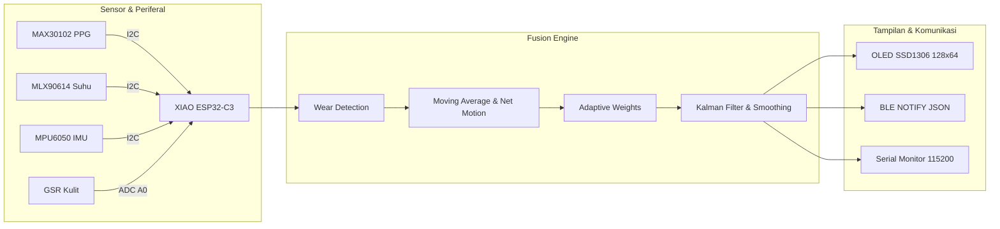

# MindTrack: Sistem Monitoring Stres Wearable (Real-time)

MindTrack adalah sistem wearable cerdas berbasis **Seeed Studio XIAO ESP32-C3** yang memantau tingkat stres pengguna secara real-time dengan menggabungkan data dari 4 sensor fisiologis menggunakan algoritma **Multi-Sensor Fusion Index**, menampilkan visualisasi data secara lokal di **Layar OLED SSD1306 (128×64)**, dan mentransmisikan data ke aplikasi ponsel (iOS/Android) via protokol **Bluetooth Low Energy (BLE)**.

---

## 1. Arsitektur & Alur Kerja Sistem (Input → Proses → Output)



### **A. Input (Sensor Data & Pin Mapping)**

Seluruh konfigurasi pin dikonsolidasikan terpusat di file [`pins_config.h`](pins_config.h).

| Sensor / Modul | Antarmuka | Pin Board (XIAO ESP32-C3) | Keterangan & Fungsi |
| :--- | :--- | :--- | :--- |
| **MAX30102 (PPG)** | I2C | SDA = GPIO 6, SCL = GPIO 7 | Detak Jantung (Heart Rate) & HRV (RMSSD). |
| **MLX90614** | I2C | SDA = GPIO 6, SCL = GPIO 7 | Sensor suhu inframerah non-kontak objek kulit. |
| **MPU6050 (IMU)** | I2C | SDA = GPIO 6, SCL = GPIO 7 | Akselerometer 3-sumbu pengukur intensitas gerak tubuh. |
| **OLED SSD1306** | I2C | SDA = GPIO 6, SCL = GPIO 7 (Alamat `0x3C`) | Layar visual monokrom 128×64 pixel. |
| **GSR (Galvanic)** | Analog ADC | Signal = **GPIO 2** (A0) | Konduktansi kulit terkait respons saraf simpatik. |

> 💡 **Catatan Jalur I2C:** Semua sensor I2C dan OLED berbagi jalur kabel yang sama (SDA GPIO6 & SCL GPIO7). OLED bersifat *non-blocking* (jika OLED tidak dipasang, program tidak akan hang dan tetap mencetak log ke Serial Monitor).

---

### **B. Proses (Algoritma Fusion Index)**

1. **Deteksi Pemakaian (Wear Detection):**
   - Nilai IR dari MAX30102 dibaca. Jika `IR < 50.000`, sensor dianggap dilepas/tidak menempel. Layar OLED menampilkan pesan *"Sensor Dilepas!"* dan metrik direset aman ke `0`.
2. **Validasi Fisiologis IBI (Inter-Beat Interval):**
   - Beat hanya dihitung jika rentang IBI berada di antara **300 ms – 2000 ms** (ekuivalen 30 – 200 BPM) untuk menyaring spike/artefak noise.
3. **HRV (RMSSD Calculation):**
   - Dihitung dari akar kuadrat rata-rata selisih kuadrat IBI berurutan dari circular buffer 10 sampel. Mengembalikan `-1` jika sampel belum mencukupi (fase inisialisasi).
4. **Sensor Fault Fallback (Anti Data 0):**
   - Menggunakan mekanisme *last-known-good* dan nilai netral fisiologis (`NEUTRAL_HR=80`, `NEUTRAL_TEMP=36.5`, `NEUTRAL_GSR=1500`) saat koneksi sensor goyang atau elektroda lepas.
5. **Reduksi Noise & Normalisasi (0–100%):**
   - Filter *Moving Average* (5 sampel) diterapkan pada semua kanal input.
   - Normalisasi Min-Max diterapkan pada tiap parameter dengan inversi khusus untuk HRV (HRV tinggi = stres rendah).
6. **Adaptive Weighting Berbasis Gerakan:**
   - Menghitung Net Motion dari MPU6050 dengan mengeliminasi gravitasi bumi (`|vector| - 9.81`).
   - Saat pengguna diam (`motion < 5`): Bobot HR & HRV ditingkatkan (dominan).
   - Saat pengguna aktif bergerak (`motion > 60`): Bobot HR & HRV diturunkan untuk mencegah artefak gerak, dialihkan ke GSR dan akselerasi.
7. **Kalman Filter & Exponential Moving Average (EMA):**
   - Menghaluskan fluktuasi tajam non-fisiologis menghasilkan indeks stres stabil (`0 - 100`).

---

### **C. Output**

#### 1. Layar OLED SSD1306 (Update per 500 ms)
```text
┌────────────────────────┐
│ MindTrack       BLE:ON │  ← Status bar & koneksi BLE
├────────────────────────┤
│ ♥  76 BPM     HRV: 42ms│  ← Detak jantung & variabilitas
│ T: 36.5°C      GSR: 30%│  ← Suhu kulit & konduktansi
│ Worn OK       [Tenang] │  ← Status pakai & kategori stres
├────────────────────────┤
│ Stress:[▓▓▓▓░░░░░]  34 │  ← Bar visual progress stres (0-100)
└────────────────────────┘
```

#### 2. Transmisi JSON via BLE NOTIFY (Update per 500 ms)
```json
{
  "worn": 1,
  "hr": 75,
  "ibi": 800,
  "hrv": 42,
  "st": 34,
  "t": 36.5,
  "g": 30,
  "ir": 120500,
  "ss": 31,
  "ts": 128,
  "ax": 0.12,
  "ay": -0.05,
  "az": 9.81
}
```

| Field JSON | Tipe / Satuan | Keterangan & Cara Interpretasi di Aplikasi |
| :--- | :--- | :--- |
| `worn` | Integer (`0` / `1`) | `1` = Alat terpasang di kulit; `0` = Alat dilepas. |
| `hr` | Integer (BPM) | Heart Rate (Detak jantung per menit). |
| `ibi` | Integer (ms) | Inter-Beat Interval (durasi jeda antar detak terakhir). |
| `hrv` | Integer (ms) | RMSSD Heart Rate Variability. Nilai `-1` menandakan fase kalibrasi awal. |
| `st` | Integer (`0–100`) | **Indeks Stres Fusi Akhir** (<30: Tenang, 30–60: Waspada, >60: Stres). |
| `t` | Float (°C) | Suhu inframerah permukaan kulit tubuh (presisi 1 desimal). |
| `g` | Integer (`0–100%`) | Persentase konduktansi kulit Galvanic Skin Response. |
| `ir` | Integer (raw) | Nilai intensitas refleksi LED inframerah sensor MAX30102. |
| `ss` | Bitmask (Integer) | **Sensor Status Health**: bit0=HR, bit1=HRV, bit2=GSR, bit3=Temp, bit4=IMU. |
| `ts` | Integer (detik) | Waktu uptime sistem sejak dinyalakan. |
| `ax, ay, az` | Float (m/s²) | Pembacaan akselerometer MPU6050 3-sumbu untuk deteksi gerak dinamis. |

> 📲 **Decoding Bitmask `ss` di Aplikasi:**
> - `ss = 31` (`0b11111`) : Semua sensor beroperasi optimal.
> - `ss = 29` (`0b11101`) : Bit 1 (`0`) → HRV sedang proses kalkulasi beat.
> - `ss = 27` (`0b11011`) : Bit 2 (`0`) → Elektroda GSR lepas / tidak terhubung.

> 📱 **Aplikasi Ponsel:**
> Repositori aplikasi Flutter pendamping tersedia di [mindtrack-app](https://github.com/ujangsprr/mindtrack-app.git).

---

## 2. Detail Komunikasi Bluetooth Low Energy (BLE)

Didesain kompatibel dengan iOS (CoreBluetooth) dan Android (BluetoothGatt):

| Parameter | Nilai Konfigurasi | Keterangan |
| :--- | :--- | :--- |
| **Device Name** | `MindTrack_BLE` | Nama yang terdeteksi saat scan. |
| **Service UUID** | `4fafc201-1fb5-459e-8fcc-c5c9c331914b` | Service Utama MindTrack. |
| **Data Characteristic** | `beb5483e-36e1-4688-b7f5-ea07361b26a8` | Properti: `READ + NOTIFY` (Kirim stream JSON). |
| **Command Characteristic**| `beb5483e-36e1-4688-b7f5-ea07361b26a9` | Properti: `WRITE` (Kirim perintah seperti `"ping"`). |
| **MTU Size** | 247 Bytes | dinegosiasikan otomatis saat handshaking. |
| **TX Power** | `ESP_PWR_LVL_P9` (+9 dBm) | Sinyal kuat dan stabil. |

---

## 3. Fitur Debugging Sensor (Uji Coba Satu Persatu)

Untuk memverifikasi hardware sensor tanpa gangguan modul lain, buka [`MindTrack.ino`](MindTrack.ino) baris 25–29, dan **uncomment salah satu baris**:

```cpp
// #define TEST_MAX30102    // Menguji HR, IBI, HRV & sensor sentuh jari
// #define TEST_MLX90614    // Menguji suhu inframerah kulit
// #define TEST_MPU6050     // Menguji accelerometer X/Y/Z & magnitude gerak
// #define TEST_GSR         // Menguji resistansi ADC elektroda kulit
// #define TEST_BLE         // Menguji koneksi nirkabel BLE dummy packet
```

> **Keunggulan Mode Test:**
> Pada setiap mode test di atas, output data akan tampil **secara visual di Layar OLED DAN tercetak terstruktur di Serial Monitor (115200 baud)** secara bersamaan!
> Jika semua baris di-comment kembali, alat otomatis kembali ke **MODE NORMAL**.

---

## 4. Struktur Modul & File

```text
MindTrack/
├── pins_config.h       — Konfigurasi pin I2C, ADC, dan OLED terpusat
├── MindTrack.ino       — Sketch utama, finite state/mode tester, BLE server, dan main loop
├── OLED.h / .cpp       — Driver tampilan SSD1306, icon grafis, splash screen, mode test
├── MAX30102.h / .cpp   — Algoritma beat detector, filter rentang fisiologis, buffer RMSSD
├── MLX90614.h / .cpp   — Pembacaan suhu objek non-kontak dan filter batas kulit manusia
├── MPU6050.h / .cpp    — Pembacaan akselerasi 3-sumbu dan kalkulasi net motion
├── GSR.h / .cpp        — Multi-sampling ADC 12-bit dan deteksi elektroda lepas
└── FusionIndex.h / .cpp— Multi-Sensor Fusion Engine (Moving Average, Adaptive Weights, Kalman, EMA)
```

---

## 5. Library yang Diperlukan (Arduino Library Manager)

Pastikan menginstal library berikut sebelum melakukan kompilasi sketch:

1. **`SparkFun MAX3010x Pulse and Proximity Sensor Library`** — SparkFun
2. **`Adafruit MLX90614 Library`** — Adafruit
3. **`Adafruit MPU6050`** — Adafruit
4. **`Adafruit Unified Sensor`** — Adafruit
5. **`Adafruit SSD1306`** — Adafruit
6. **`Adafruit GFX Library`** — Adafruit
7. **`ArduinoJson`** (v6.x) — Benoit Blanchon
8. **`NimBLE-Arduino`** (v1.4+) — h2zero

**Pilihan Board di Arduino IDE:**  
`Seeed Studio XIAO ESP32-C3` (*Board Package: esp32 by Espressif Systems*).

---

## 📄 Lisensi & Kontributor
Proyek ini dirilis di bawah lisensi MIT.  
Dikembangkan oleh [Ujang](https://github.com/ujangsprr) untuk riset dan implementasi sistem wearable monitoring stres.

